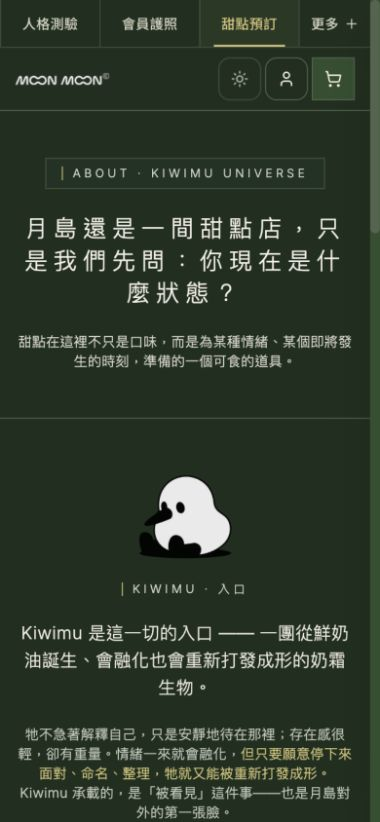
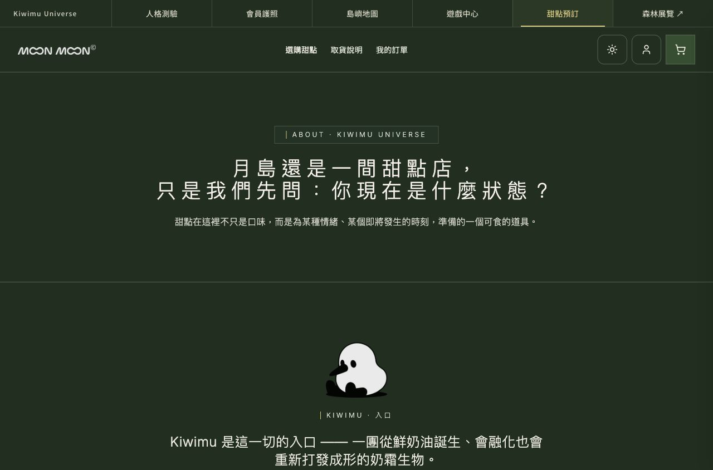
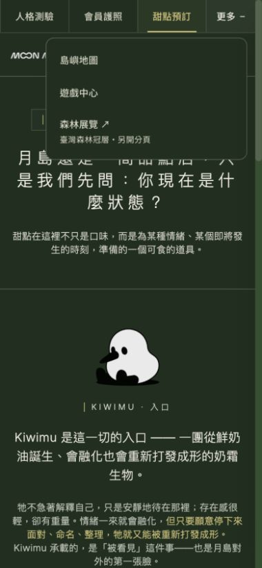

# Shop 月島共同導覽候選｜2026-10-13

Penso 要求全部上方 bar 統一；以已上線的 Passport 深綠導覽為基準。

## 改動

深綠 `#1F2F1F`、奶油白 `#F5F0E8`、柔金 `#D7C678`。中文入口 14px、操作區 48px。桌機保留五站與森林展覽；手機顯示人格測驗／會員護照／甜點預訂，其餘放在「更多」。支援 Escape、點外部、離開焦點與切回桌機時收合。

共同導覽 z-index 35，低於購物車遮罩 40／抽屜 50。桌機相鄰 `.shop-navbar` 的 top 取共同導覽實測高度；實際捲動至 scrollTop 2488 時為 49px。沒有改訂單／付款／後台或 PR #26。

## 驗證

`npx tsc --noEmit`、`npm run build`、logout-result／resend-results／shop-security 全部通過；lint 0 error／11 既有 warning。

作者內建瀏覽器 9 案：320／390／768／1280px 與本專案公開頁，水平溢出 0，導覽顏色、字級與 ≥44px 操作區通過；「更多」與 Escape 正常。另驗空購物車覆層及捲動頁首。Shop 首頁 API 在 QA 中被隔離，商品載入失敗殼不當菜單驗收；截圖使用 `/about` 的完整公開內容。

獨立程式覆核 APPROVE；runtime diff SHA256：`c9b7fdff7c69cdc52912c33389a146ce8e4893030ad48a8e51bf79ce1d20cf2d`。作者瀏覽器 QA 不等於獨立視覺或真人簽收。

## 狀態與限制

候選尚未合併、未部署 production；須 Penso 批准。不是五站完整內容驗收；未真人 Safari／LINE／VoiceOver、登入、交易、抽獎、點數／核銷或通知送達驗收。QA 過程隔離 API 與分析。

本機：[候選預覽](http://127.0.0.1:5254/about)

## 畫面

## CI 發現後的追加驗證

更多文字與全形加號允許自然換行，保留 48px 最小高度與焦點機制。最終五站20尺寸案與各站390px開／關10案均通過；原多路由36案是追加前的證據。MBTI額外20 accessibility／44 V2／110 report-reading／4生成器通過，不擴張成其他站真人流程驗收。完整桌機截圖以明確1280×844 clip重拍，避免內建瀏覽器面板裁切。
